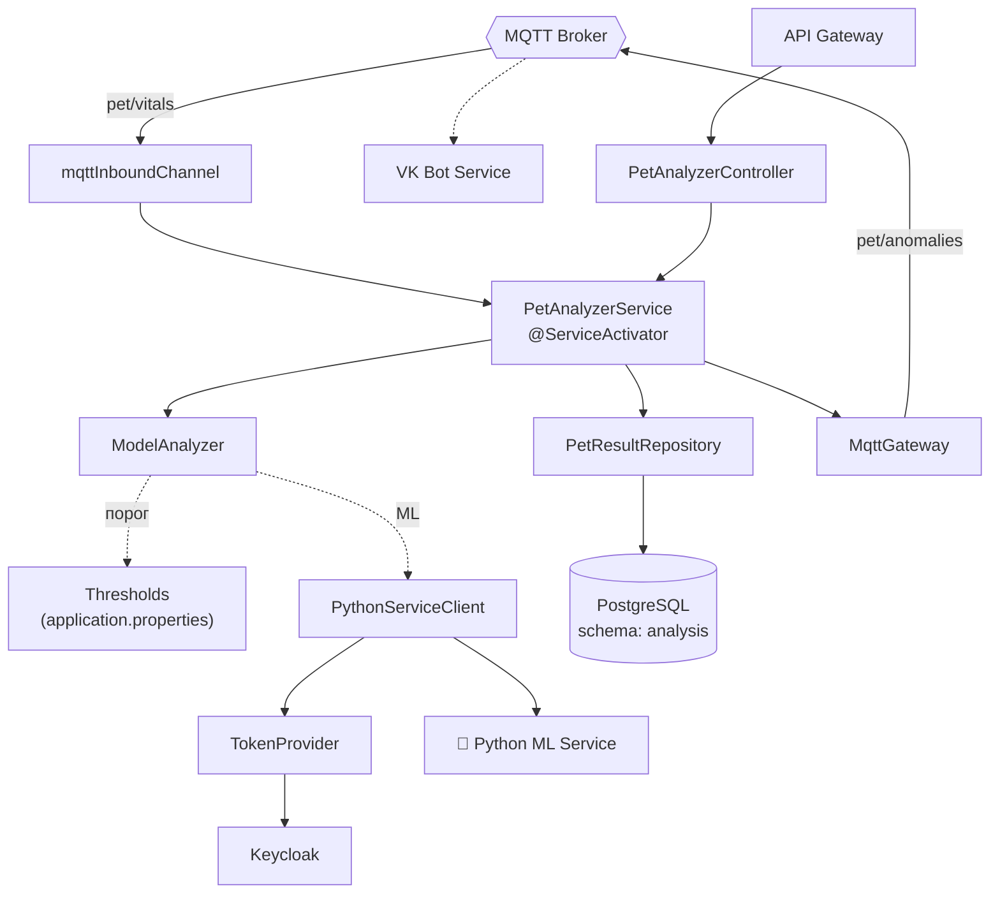
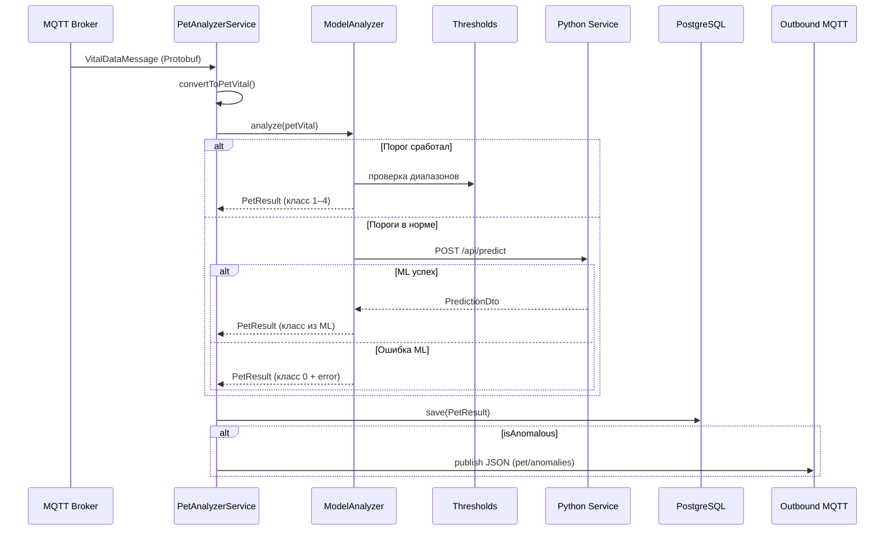

# 🧠 Pet Health Analyzer


> Аналитический сервис: приём телеметрии с умных ошейников, двухуровневый анализ (пороговые правила + ML-модель), генерация рекомендаций и публикация аномалий.

---

## 📋 Назначение

**Pet Health Analyzer** — интеллектуальное ядро платформы, отвечающее за мониторинг состояния здоровья питомцев. Сервис подписан на MQTT-топик `pet/vitals`, принимает поток телеметрии от Pet Wearable Service, обрабатывает каждое сообщение и сохраняет результат анализа в PostgreSQL.

Ключевые задачи:

- приём потока телеметрии из MQTT и десериализация из Protobuf;
- **двухуровневый анализ** каждого измерения:
  1. **Пороговые правила** — быстрая детекция явных аномалий (пульс, дыхание, температура, расстояние);
  2. **ML-модель** — при отсутствии явных отклонений вызов Python-сервиса для тонкой классификации;
- сохранение каждого результата в БД;
- публикация аномалий в MQTT-топик `pet/anomalies` для оповещения владельца через VK-бота;
- агрегация статистики за период (день / неделя / месяц) и генерация **персонализированных рекомендаций**;
- REST API для получения истории показателей, последнего замера и рекомендаций.

Сервис работает в режиме **потоковой обработки** — весь входящий трафик идёт через MQTT, а REST используется только клиентами для чтения.

---

## ✨ Ключевые возможности

### Двухуровневый анализ (`ModelAnalyzer`)

Первый уровень — **детерминированные пороговые правила**, заданные в `application.properties`. Проверяются в строгом порядке:

| Проверка | Условие | Класс аномалии |
|---|---|---|
| Пульс | вне `[30, 200]` уд/мин | 1 — `ABNORMAL_HEART_RATE` |
| Дыхание | вне `[10, 40]` дых/мин | 2 — `ABNORMAL_RESPIRATION` |
| Температура | вне `[36.0, 41.0]` °C | 3 — `ABNORMAL_TEMPERATURE` |
| Расстояние от дома | > `distanceLimit` | 4 — `TOO_FAR_FROM_HOME` |

Если ни одно правило не сработало — второй уровень: **запрос к Python-сервису** (`POST /api/predict`), который возвращает `PredictionDto` с классом аномалии (0 = норма) и вектором вероятностей. Эта модель способна улавливать **менее очевидные патологии**, которые не детектируются простыми порогами.

Результат в обоих случаях сохраняется как `PetResult` с признаком `isAnomalous`, номером класса, типом `AnomalyType` и словарём `details` (для пороговых срабатываний — конкретное значение вышедшего за границы параметра; для ML — вероятности по классам).

При ошибке вызова Python-сервиса формируется **нейтральный результат** с `anomalyClass = 0`, а сообщение об ошибке сохраняется в `details.error`. Это позволяет не терять данные и проводить пост-фактум-анализ сбоев.

### Потоковая обработка через MQTT

`PetAnalyzerService.handleVitalData` аннотирован `@ServiceActivator` и подключён к входящему каналу `mqttInboundChannel`. Алгоритм:

1. Десериализация Protobuf-сообщения `VitalDataMessage`.
2. Конвертация в `PetVital` с проверками на пустые/нулевые значения (`convertToPetVital`).
3. Вызов `modelAnalyzer.analyze(petVital)`.
4. Сохранение `PetResult` в PostgreSQL.
5. Если `result.isAnomalous()` — сериализация в JSON и публикация в `pet/anomalies`.

Обработка обёрнута в `try/catch` — сбой на одном сообщении не останавливает поток.

### Автоматическое определение статуса ошейника

Метод `determineCollarStatus` сравнивает временную метку последнего замера с текущим временем. Если разница **меньше 5 минут** — ошейник считается `online`, иначе — `offline`. Это даёт клиенту возможность сразу понять, актуальны ли данные.

### Генерация рекомендаций

Метод `getRecommendations` принимает `petId` и `Period` (`DAY` / `WEEK` / `MONTH`), агрегирует историю и формирует `RecommendationDto`:

- **`summary`** — текстовая сводка за период: количество аномалий, топ-3 проблемных типа с частотами, средние значения показателей;
- **`recommendations`** — список практических советов, сформированных по правилам:
  - при обнаружении `ABNORMAL_HEART_RATE` — консультация кардиолога;
  - при `ABNORMAL_RESPIRATION` — проверка качества воздуха;
  - при `ABNORMAL_TEMPERATURE` — температурный режим;
  - при `TOO_FAR_FROM_HOME` — внимание к местоположению;
  - при среднем пульсе > 100 или < 60 — соответствующие предупреждения;
  - при средней температуре > 39.0 или < 37.5 — температурные рекомендации.

Если данных за период нет — возвращается **пустая рекомендация** с просьбой проверить ошейник и пополнить данные. Если показатели в норме — рекомендации общего характера (продолжать наблюдение и текущий режим ухода).

### Агрегация статистики (`HealthStats`)

Формируются средние значения пульса, дыхания, температуры (округление до 1 знака), количество аномалий и общее число измерений. Эти данные — основа для `RecommendationDto.stats`.

---

## 🛠 Технологический стек

| Компонент | Технология |
|---|---|
| Язык | Java 21 |
| Фреймворк | Spring Boot 3 |
| Интеграция | Spring Integration (MQTT in/out) |
| Формат данных | Protocol Buffers 3 |
| БД | PostgreSQL 16 (схема `analysis`) |
| ORM | Spring Data JPA, Hibernate |
| Миграции | Liquibase |
| ML-сервис | Python (внешний) |
| Безопасность | Spring Security OAuth2 Client, Keycloak |
| Планировщик | Spring `@Scheduled` (в родительском конфиге) |
| Логирование | SLF4J + Logback |
| Контейнеризация | Docker (multi-stage build) |

---

## 🏗 Архитектура сервиса



---

## 📁 Структура проекта

```
pet-health-analyzer-service/
├── src/main/java/ru/sibsutis/pet_health_analyzer/
│   ├── PetHealthAnalyzerApplication.java
│   ├── api/
│   │   ├── PetAnalyzerController.java
│   │   ├── client/
│   │   │   ├── PythonServiceClient.java
│   │   │   └── TokenProvider.java
│   │   └── dto/
│   │       ├── LatestPetResultDto.java
│   │       ├── PetResultDto.java
│   │       ├── PredictionDto.java
│   │       └── RecommendationDto.java
│   └── core/
│       ├── model/
│       │   ├── AnomalyType.java
│       │   ├── HealthStats.java
│       │   ├── Location.java
│       │   ├── Period.java
│       │   ├── PetResult.java
│       │   └── PetVital.java
│       ├── repository/
│       │   └── PetResultRepository.java
│       └── service/
│           ├── ModelAnalyzer.java
│           ├── PetAnalyzerService.java
│           └── MqttGateway.java
├── src/main/proto/
│   └── vital_data.proto
├── src/main/resources/
│   └── application.properties
├── Dockerfile
├── build.gradle
└── README.md
```

---

## 📡 API

Все запросы идут через **API Gateway** (`/api/health/**`) с JWT в заголовке `Authorization: Bearer <token>`.

| Метод | Путь | Описание |
|---|---|---|
| `GET` | `/health/vitals/{petId}?period=day\|week\|month` | История показателей за период |
| `GET` | `/health/vitals/{petId}/latest` | Последний замер + статус ошейника |
| `GET` | `/health/recommendations/{petId}` | Рекомендации за день (кэшированные) |
| `POST` | `/health/analyze/{petId}?period=week` | Принудительный анализ и генерация рекомендаций |

### Пример: история за неделю

```http
GET /api/health/vitals/81e9f1d3-...?period=week
Authorization: Bearer <JWT>
```

```json
[
  {
    "timestamp": "2026-10-07T14:22:11+00:00",
    "petId": "81e9f1d3-...",
    "heartRate": 95,
    "respiratoryRate": 22,
    "temperature": 38.3,
    "location": { "lat": 82.95, "lon": 55.01, "distanceFromHome": 0.34, "distanceLimit": 10 },
    "isAnomalous": false,
    "anomalyReason": null
  }
]
```

### Пример: последний замер

```http
GET /api/health/vitals/81e9f1d3-.../latest
```

```json
{
  "timestamp": "2026-10-07T14:22:11+00:00",
  "petId": "81e9f1d3-...",
  "heartRate": 195,
  "respiratoryRate": 22,
  "temperature": 38.3,
  "isAnomalous": true,
  "anomalyReason": "Класс аномалии: 1, краткое описание: проблемы с пульсом",
  "collarStatus": "online"
}
```

### Пример: анализ за неделю

```http
POST /api/health/analyze/81e9f1d3-...?period=week
```

```json
{
  "petId": "81e9f1d3-...",
  "generatedAt": "2026-10-07T14:22:11Z",
  "period": "week",
  "summary": "За прошедшую неделю обнаружено 3 аномальных показателей. Основные проблемы:\n• Проблемы с пульсом (2 раз)\n• Питомец слишком далеко от дома (1 раз)\n\nСредние значения в норме: пульс 92.3, дыхание 22.1, температура 38.2.",
  "recommendations": [
    "Рекомендуется проконсультироваться с ветеринаром",
    "Выявлены проблемы с сердечным ритмом. Рекомендуется снизить стрессовые нагрузки",
    "Питомец слишком далеко от дома! Будьте внимательны."
  ],
  "stats": {
    "avgHeartRate": 92.3,
    "avgRespiratoryRate": 22.1,
    "avgTemperature": 38.2,
    "anomalyCount": 3,
    "totalReadings": 168
  }
}
```

### Обработка ошибок

| Ситуация | HTTP-статус | Комментарий |
|---|---|---|
| Нет данных для анализа | 404 / 500 | `RuntimeException("No vitals data available")` при `POST /analyze` |
| Некорректный `period` | 200 | По умолчанию `WEEK` (fallback в `Period.fromString`) |

---

## 🗄 Модель данных

### Сущность `PetResult` (PostgreSQL, схема `analysis`)

| Поле | Тип | Описание |
|---|---|---|
| `id` | UUID | PK, автогенерация |
| `petId` | String | ID питомца (обязательно) |
| `heartRate` | Integer | Пульс |
| `respiration` | Integer | Дыхание |
| `temperature` | Double | Температура |
| `isAnomalous` | Boolean | Признак аномалии |
| `anomalyClass` | int | Номер класса (0 — норма) |
| `anomalyType` | Enum | `AnomalyType` (string) |
| `location` | Location | Встраиваемый объект (`@Embeddable`) |
| `details` | JSONB | Доп. сведения (значения, вероятности, ошибки) |
| `timestamp` | Long | Unix-время |

### Enum `AnomalyType`

| Код | Название | Friendly |
|---|---|---|
| 0 | `NORMAL` | Всё в порядке |
| 1 | `ABNORMAL_HEART_RATE` | Проблемы с пульсом |
| 2 | `ABNORMAL_RESPIRATION` | Проблемы с дыханием |
| 3 | `ABNORMAL_TEMPERATURE` | Проблемы с температурой |
| 4 | `TOO_FAR_FROM_HOME` | Питомец слишком далеко от дома |
| 5 | `UNKNOWN` | Не удалось определить состояние |

### Enum `Period`

- `DAY` — последние 24 часа;
- `WEEK` — последние 7 дней (по умолчанию);
- `MONTH` — последние 30 дней.

Метод `calculateStartTimestamp()` возвращает Unix-время начала периода.

### Пороги (`application.properties`)

```properties
thresholds.heart-rate-min=30
thresholds.heart-rate-max=200
thresholds.respiration-min=10
thresholds.respiration-max=40
thresholds.temperature-min=36.0
thresholds.temperature-max=41.0
```

### Репозиторий

```java
List<PetResult> findByPetIdAndTimestampGreaterThanEqualOrderByTimestampAsc(String petId, Long timestamp);
Optional<PetResult> findTopByPetIdOrderByTimestampDesc(String petId);
```

---

## 🔄 Ключевые сценарии

### Обработка входящей телеметрии



### Генерация рекомендаций

1. Клиент вызывает `POST /analyze/{petId}?period=week`.
2. Сервис вычисляет `startTimestamp` через `Period.calculateStartTimestamp()`.
3. Загружает историю `findByPetIdAndTimestampGreaterThanEqual...`.
4. Если история пуста — возвращает `generateEmptyRecommendation` с просьбой проверить ошейник.
5. Иначе считает статистику (`calculateStats`).
6. Формирует `summary` через `generateSummary` (топ-3 аномалий + средние).
7. Формирует `recommendations` через `generateRecommendations` (правила по типам аномалий + средним значениям).
8. Собирает `RecommendationDto`.

---

## ⚙️ Конфигурация

### Переменные окружения

| Переменная | Назначение | Значение по умолчанию |
|---|---|---|
| `DB_HOST` / `DB_PORT` | PostgreSQL | `localhost` / `5433` |
| `DB_USERNAME` / `DB_PASSWORD` | Учётные данные | `postgres` / — |
| `MQTT_HOST` / `MQTT_PORT` | MQTT-брокер | `localhost` / `1883` |
| `KEYCLOAK_ISSUER_URI` | Issuer URI Keycloak | `http://localhost:8080/realms/clinic-realm` |
| `KEYCLOAK_CLIENT_SECRET` | Секрет `pet-health-analyzer-service` | — |
| `GATEWAY_HOST` / `GATEWAY_PORT` | API Gateway | `localhost` / `8888` |

### Настройка Spring Integration

Требуются:
- `mqttInboundChannel` — `MessageChannel` для входящих сообщений;
- `mqttOutboundChannel` — `MessageChannel` для исходящих;
- `MqttPahoMessageDrivenChannelAdapter` — подписка на `pet/vitals`;
- `MqttPahoMessageHandler` — публикация в `pet/anomalies`.

---

## 🚀 Запуск

### Локально (Docker Compose)

```bash
docker compose up -d pet-health-analyzer-service postgres mosquitto python-ml keycloak
```

### Запуск только сервиса

```bash
cd services/pet-health-analyzer
./gradlew bootRun
```

### Сборка образа

```bash
docker build -t pet-health-analyzer-service:latest .
```

### Проверка

```bash
# Health
curl http://localhost:8084/actuator/health

# Подписка на публикуемые аномалии
mosquitto_sub -h localhost -p 1883 -t "pet/anomalies" -v

# Авторизованный запрос
curl -H "Authorization: Bearer $TOKEN" \
     http://localhost:8888/api/health/vitals/81e9f1d3-.../latest
```

---

## 🔗 Связанные сервисы

| Сервис | Взаимодействие |
|---|---|
| **Pet Wearable Service** | Источник Protobuf-сообщений в топик `pet/vitals` |
| **Python ML Service** | Вызывается синхронно через `POST /api/predict` |
| **VK Bot Service** | Подписан на `pet/anomalies`, рассылает уведомления владельцам |
| **API Gateway** | Маршрутизация REST-запросов на чтение |
| **Keycloak** | OAuth2 для вызова Python-сервиса |

---
